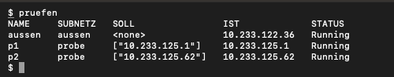
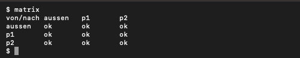
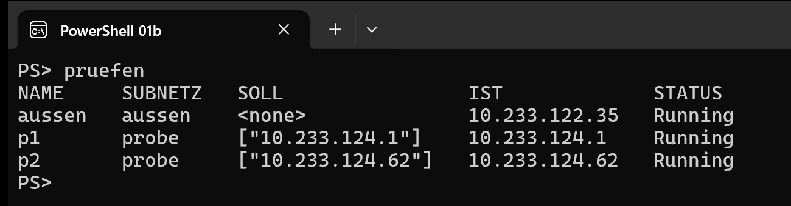
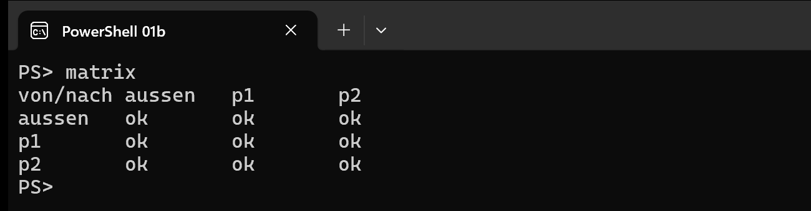

# 01b · Subnetze anlegen

<a class="md-button" href="../../pdf/01b-subnetze.pdf">:material-file-pdf-box: Als PDF herunterladen</a>

--8<-- "konventionen.md"

In Versuch 01 hat die Plattform entschieden: Jeder Pod bekommt irgendeine
Adresse mit der Maske `/32`, und im Pod dürft ihr nichts ändern. Jetzt
entscheidet ihr. Ihr bekommt einen **Adressblock**, teilt ihn in **Subnetze**,
legt eure Pods an **selbst gewählte Adressen** und konfiguriert für jedes
Subnetz, **wer hinein darf**. Ob eure Rechnung stimmt, zeigt das Netz: Eine
falsche Maske lässt den falschen Pod durch oder sperrt den richtigen aus.

Die ICC gibt euch dafür zwei Stellschrauben, beide ohne Sonderrechte im Pod:

| Stellschraube | Womit | Wirkung |
|---|---|---|
| **Adresse** eines Pods | Annotation `cni.projectcalico.org/ipAddrs` am Pod | Calico, die Netzsoftware der ICC, vergibt genau diese Adresse statt einer beliebigen. |
| **Grenze** eines Subnetzes | NetworkPolicy mit `ipBlock: {cidr: …}` (Versuch 05) | Nur Absender aus den genannten Netzen erreichen die Pods des Subnetzes. |

Ein Subnetz existiert hier also nicht als Maske im Pod (die bleibt `/32`),
sondern als **Adressbereich in euren Regeln**. So arbeiten auch
Sicherheitsgruppen und Netz-ACLs in der Cloud.

!!! warning "Euren Adressblock bekommt ihr in der Veranstaltung"
    Adressblock und Anforderungen an die Subnetze teilt die Kursleitung in der
    Stunde aus. Verwendet **nur Adressen aus eurem Block**. Der Adressraum der
    ICC ist gemeinsam genutzt: Eine Adresse, die ein anderer Pod schon hat,
    bekommt ihr nicht, und eine Adresse, die ihr belegt, fehlt anderen.

## Lernziele

Nach dem Versuch könnt ihr …

- einen Adressblock nach Anforderungen in **Subnetze unterschiedlicher Größe**
  teilen und für jedes Netzadresse, Maske, Hostbereich und Broadcast angeben,
- Pods an **geplante Adressen** legen und Fehler bei der Vergabe deuten,
- Subnetzgrenzen als **Regeln in CIDR-Schreibweise** konfigurieren,
- an einer **Erreichbarkeitsmatrix** prüfen, ob das Netz dem Plan entspricht.

## Aufbau

Ein eigener Namespace und vier Hilfsfunktionen:

- `anlegen <name> <adresse> <subnetz>` legt einen Pod an der Adresse an und
  merkt sich sein Subnetz als Label. Mit `auto` statt einer Adresse vergibt die
  ICC die Adresse selbst (ein Pod „von außen").
- `regel <subnetz> [<netz>/<präfix> …]` legt fest, aus welchen Netzen die Pods
  des Subnetzes erreichbar sind. Ohne Netz ist das Subnetz für alle anderen
  gesperrt. Soll ein Subnetz für alle offen sein, schreibt ihr gar keine Regel
  dafür oder nennt ein Netz, das jede IPv4-Adresse umfasst (welches Präfix hat
  es?). Ein neuer Aufruf für dasselbe Subnetz ersetzt die alte Regel.
- `pruefen` zeigt Soll- und Ist-Adresse jedes Pods. Bekommt ein Pod keine
  Adresse, steht unter der Tabelle eine Zeile mit Podname und Grund.
- `matrix` pingt von jedem Pod zu jedem und zeigt, wer wen erreicht (Zeile =
  Absender, Spalte = Empfänger). Die Pods stehen alphabetisch sortiert; schreibt
  eure Soll-Matrix in derselben Reihenfolge. Die Diagonale ist immer `ok`, denn
  ein Pod erreicht sich selbst an jeder Regel vorbei.

=== "Bash"

    ```bash
    export NS=wab123
    kubectl create ns $NS-sn
    until kubectl auth can-i create pods -n $NS-sn | grep -q yes \
       && kubectl auth can-i get pods -n $NS-sn | grep -q yes; do sleep 1; done

    anlegen() {  # anlegen <name> <adresse|auto> <subnetz>
      local ann=""
      [ "$2" != auto ] && ann="  annotations: {cni.projectcalico.org/ipAddrs: '[\"$2\"]'}"
      kubectl -n $NS-sn apply -f - <<EOF
    apiVersion: v1
    kind: Pod
    metadata:
      name: $1
      labels: {subnetz: $3}
    $ann
    spec:
      terminationGracePeriodSeconds: 1
      containers:
      - name: s
        image: ghcr.io/scimbe/cads-icc-praktikum-tools:0.1.0
        command: ["python3", "/opt/lab/labsrv.py"]
        resources: {requests: {cpu: 10m, memory: 32Mi}, limits: {cpu: 100m, memory: 64Mi}}
    EOF
    }

    regel() {  # regel <subnetz> [<netz>/<präfix> ...]
      local netz=$1; shift
      { echo "apiVersion: networking.k8s.io/v1"
        echo "kind: NetworkPolicy"
        echo "metadata: {name: in-$netz}"
        echo "spec:"
        echo "  podSelector: {matchLabels: {subnetz: $netz}}"
        echo "  policyTypes: [Ingress]"
        if [ $# -eq 0 ]; then echo "  ingress: []"; else
          echo "  ingress:"; echo "  - from:"
          for c in "$@"; do echo "    - ipBlock: {cidr: $c}"; done
        fi
      } | kubectl -n $NS-sn apply -f -
    }

    pruefen() {
      kubectl -n $NS-sn get pods -o custom-columns='NAME:.metadata.name,SUBNETZ:.metadata.labels.subnetz,SOLL:.metadata.annotations.cni\.projectcalico\.org/ipAddrs,IST:.status.podIP,STATUS:.status.phase'
      kubectl -n $NS-sn get events --field-selector reason=FailedCreatePodSandBox \
        -o custom-columns=POD:.involvedObject.name,GRUND:.message --no-headers \
        | sed -E 's/ +.*IPAM: /  /' | sort -u
    }

    matrix() {
      local liste ips
      liste=$(kubectl -n $NS-sn get pods --field-selector=status.phase=Running \
        -o custom-columns=N:.metadata.name,IP:.status.podIP --no-headers)
      ips=$(echo "$liste" | awk '{print $2}' | tr '\n' ' ')
      printf '%-9s' 'von/nach'; echo "$liste" | awk '{printf "%-9s", $1}'; echo
      echo "$liste" | while read -r name ip; do
        printf '%-9s' "$name"
        kubectl -n $NS-sn exec "$name" -- sh -c "for ip in $ips; do if ping -c1 -W1 \$ip >/dev/null 2>&1; then printf '%-9s' ok; else printf '%-9s' -; fi; done" </dev/null
        echo
      done
    }
    ```

=== "PowerShell"

    ```powershell
    $NS = "wab123"
    kubectl create ns "$NS-sn"
    do { Start-Sleep 1 } until ((kubectl auth can-i create pods -n "$NS-sn") -eq "yes" -and (kubectl auth can-i get pods -n "$NS-sn") -eq "yes")

    function anlegen($Name, $Adresse, $Subnetz) {
      $ann = if ($Adresse -ne "auto") { "  annotations: {cni.projectcalico.org/ipAddrs: '[`"$Adresse`"]'}" } else { "" }
    @"
    apiVersion: v1
    kind: Pod
    metadata:
      name: $Name
      labels: {subnetz: $Subnetz}
    $ann
    spec:
      terminationGracePeriodSeconds: 1
      containers:
      - name: s
        image: ghcr.io/scimbe/cads-icc-praktikum-tools:0.1.0
        command: ["python3", "/opt/lab/labsrv.py"]
        resources: {requests: {cpu: 10m, memory: 32Mi}, limits: {cpu: 100m, memory: 64Mi}}
    "@ | kubectl -n "$NS-sn" apply -f -
    }

    function regel($Subnetz) {
      $kopf = "apiVersion: networking.k8s.io/v1`nkind: NetworkPolicy`nmetadata: {name: in-$Subnetz}`nspec:`n  podSelector: {matchLabels: {subnetz: $Subnetz}}`n  policyTypes: [Ingress]"
      if ($args.Count -eq 0) { $rumpf = "  ingress: []" }
      else { $rumpf = "  ingress:`n  - from:`n" + (($args | ForEach-Object { "    - ipBlock: {cidr: $_}" }) -join "`n") }
      "$kopf`n$rumpf" | kubectl -n "$NS-sn" apply -f -
    }

    function pruefen {
      kubectl -n "$NS-sn" get pods -o custom-columns='NAME:.metadata.name,SUBNETZ:.metadata.labels.subnetz,SOLL:.metadata.annotations.cni\.projectcalico\.org/ipAddrs,IST:.status.podIP,STATUS:.status.phase'
      kubectl -n "$NS-sn" get events --field-selector reason=FailedCreatePodSandBox -o custom-columns=POD:.involvedObject.name,GRUND:.message --no-headers |
        ForEach-Object { $_ -replace ' +.*IPAM: ', '  ' } | Sort-Object -Unique
    }

    function matrix {
      $liste = kubectl -n "$NS-sn" get pods --field-selector=status.phase=Running -o custom-columns=N:.metadata.name,IP:.status.podIP --no-headers |
        Where-Object { $_ } | ForEach-Object { ,($_ -split '\s+') }
      $ips = ($liste | ForEach-Object { $_[1] }) -join " "
      ("{0,-9}" -f "von/nach") + (($liste | ForEach-Object { "{0,-9}" -f $_[0] }) -join "")
      foreach ($p in $liste) {
        $zeile = kubectl -n "$NS-sn" exec $p[0] -- sh -c "for ip in $ips; do if ping -c1 -W1 `$ip >/dev/null 2>&1; then printf '%-9s' ok; else printf '%-9s' -; fi; done"
        ("{0,-9}" -f $p[0]) + $zeile
      }
    }
    ```

!!! tip "Neues Terminal?"
    Die Funktionen leben nur im Terminal, in dem ihr den Block ausgeführt habt.
    In einem neuen Terminal setzt ihr `KUBECONFIG` und `NS` und führt den Block
    noch einmal aus. `kubectl create ns` meldet dann `AlreadyExists`, das ist
    harmlos.

## Probelauf

Bevor ihr euer Netz baut, prüft ihr die Werkzeuge mit **zwei Adressen aus
eurem Block**: der ersten und der letzten nutzbaren Adresse (Netz- und
Broadcastadresse des Blocks gehören nicht dazu). Setzt sie für
`<erste>` und `<letzte>` ein. Dazu kommt ein Pod mit automatischer Adresse;
legt ihn **zuerst** an.

```bash
anlegen aussen auto aussen
```

Wartet, bis `pruefen` für `aussen` eine Adresse zeigt, dann:

```bash
anlegen p1 <erste> probe
anlegen p2 <letzte> probe
```

Wartet etwa 20 Sekunden, dann:

```bash
pruefen
matrix
```

**Vorhersage:** Wer erreicht wen, solange es keine Regel gibt?

??? example "So sieht die Ausgabe aus (erst nach eurer Vorhersage aufklappen)"
    Die Adressen sind bei euch andere; entscheidend ist, dass `SOLL` und `IST`
    übereinstimmen und alle Pods `Running` sind.

    === "Bash"

        { width="500" }

        { width="500" }

    === "PowerShell"

        { width="560" }

        { width="560" }

Jetzt eine Regel: Ins Subnetz `probe` darf nur, wer aus eurem Block kommt.
Setzt euren Block in CIDR-Schreibweise ein:

```bash
regel probe <block>/<präfix>
```

Wartet einige Sekunden, dann `matrix`.

!!! question "Probe"
    Erreicht `aussen` jetzt noch `p1` und `p2`? Erreichen sich `p1` und `p2`
    gegenseitig? Ist beides so, wie ihr es vorhergesagt habt, sind eure
    Werkzeuge bereit. Liegt die Adresse von `aussen` überraschend in eurem
    Block, notiert das; es ist kein Fehler eurer Werkzeuge. Löscht die Probe mit
    `kubectl -n $NS-sn delete pod p1 p2 aussen` und
    `kubectl -n $NS-sn delete networkpolicy in-probe`.

## Wenn etwas hängt

- **Ein Pod bleibt hängen** (`pruefen` zeigt `Pending`, `kubectl get pods`
  zeigt `ContainerCreating`): `pruefen` schreibt unter die Tabelle eine Zeile mit
  Podname und Grund. Ein Pod mit falscher Adresse
  wird nicht repariert: Löscht ihn (`kubectl -n $NS-sn delete pod <name>`) und
  legt ihn mit der richtigen Adresse neu an.
- **Eine geplante Adresse ist schon vergeben:** Steht sie in der Spalte `IST`
  eines eurer Pods, habt ihr sie doppelt geplant. Sonst hat sie ein Pod, den ihr
  nicht angelegt habt. Nehmt die nächste freie Adresse im selben
  Subnetz und tragt die Änderung in euren Adressplan ein. Legt Pods mit `auto`
  an, **bevor** ihr die Pods mit fester Adresse anlegt.
- **`SOLL` und `IST` passen nicht zusammen:** `anlegen` mit dem Namen eines
  Pods, den es schon gibt, ändert nur die geplante Adresse (`SOLL`), nicht die
  vergebene (`IST`). Löscht den Pod und legt ihn neu an.
- **`regel` wird abgelehnt:** Lest die Meldung von `kubectl` genau. Sie nennt
  das Feld und den Wert, der nicht passt.
- **`matrix` zeigt einen Pod nicht:** Sie zeigt nur Pods im Zustand
  `Running`.
- **Eine Regel wirkt nicht sofort:** Wartet nach `regel` einige Sekunden, bevor
  ihr messt.
- **Eine Zelle der Matrix weicht vom Soll ab:** Seht mit
  `kubectl -n $NS-sn get networkpolicy -o yaml` nach, welche Netze die Regel des
  **Empfänger**-Subnetzes wirklich enthält, und rechnet nach, ob die Adresse des
  Absenders darin liegt.

!!! info "Was ihr nicht konfigurieren könnt"
    Masken, Routen und Schnittstellen im Pod bleiben gesperrt (Versuch 01,
    Aufgabe 4). Eigene Adressbereiche (IP-Pools) für die ganze ICC legt nur
    der Betrieb an. Ihr arbeitet innerhalb dessen, was die Plattform freigibt.
    Das gehört zur Aufgabe.

## Aufräumen

```bash
kubectl delete ns $NS-sn
```

Damit sind auch eure Adressen wieder frei.

## Selbsttest

- [ ] Ich kann zu einem Subnetz Netzadresse, Maske, ersten und letzten Host und
      Broadcast angeben.
- [ ] Ich kann einen Pod an eine geplante Adresse legen und erkenne an
      `pruefen`, warum eine Adresse nicht vergeben wird.
- [ ] Ich kann begründen, welche Pods eine Regel mit einem bestimmten Präfix
      erfasst und welche nicht.

--8<-- "issue-feedback.md"
